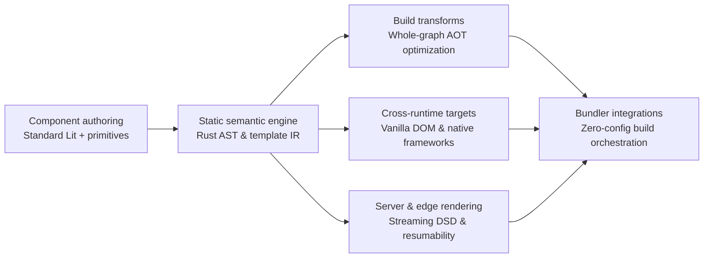

# lit-core

---

## Overview

`@lit-core` is a native Rust ahead-of-time (AOT) compiler toolchain and execution platform for Lit and Web Components.

It turns standard Lit components into a universal, zero-overhead authoring format—shifting style deduplication, template compilation, reactivity wiring, and runtime lifecycle work from the user's browser to build time. Teams write standard components once and deploy them as hyper-optimized Lit bundles, zero-JavaScript resumable server streams, standalone vanilla Custom Elements, or native components for other UI frameworks.

---

## Why `@lit-core`

Web Components offer browser-native encapsulation through the Shadow DOM, but that encapsulation introduces fundamental costs at scale:

- **Shadow DOM style bloat**: Because global stylesheets cannot cross shadow boundaries, component libraries repeat theme tokens, resets, and layout rules inside every component.
- **Client-side runtime tax**: Standard components parse HTML strings, walk DOM trees via `TreeWalker` to locate binding markers, evaluate decorator metadata, and allocate directive wrappers on the client main thread.
- **Eager hydration bottlenecks**: Server-rendered Web Components traditionally require downloading and executing the full component graph upfront before the page becomes interactive.
- **Framework lock-in and wrapper friction**: Sharing Web Component design systems with framework ecosystems often relies on runtime custom-element wrappers that struggle with SSR, event semantics, and bundle duplication.

`@lit-core` eliminates these trade-offs at compile time through static semantic analysis, whole-bundle graph optimization, and multi-target code generation.

---

## Platform pillars

### Authoring primitives
Ergonomic, developer-facing decorators, reactive state primitives, and component helpers designed from the ground up for static analysis. Authoring primitives provide rich TypeScript type safety and IDE ergonomics while compiling down to zero runtime overhead during the build.

### Build transforms
Composable ahead-of-time AST passes that optimize standard Lit applications without changing how components are written:
- **Cross-component stylesheet & fragment fusion**: Extracts duplicated CSS rules and static HTML/SVG subtrees across components into shared constructable stylesheets and template constants instantiated once in memory.
- **Zero-traversal mounting & precompiled templates**: Compiles template strings into static descriptors with precomputed DOM child-index paths and ShadowRoot event delegation, bypassing runtime HTML parsing and `TreeWalker` traversal.
- **Reactivity, decorator & directive inlining**: Lowers decorators into static class definitions, compiles directives into direct DOM mutations, auto-memoizes reactive expressions, and computes property-to-part dependency bitmasks.
- **Whole-program dead code elimination**: Analyzes the application graph to shake unreferenced Custom Element registrations and defer offscreen component upgrades.

### Cross-runtime targets
Full cross-compilation pipelines that lower Lit components into entirely different runtime targets when shipping the Lit runtime is not desired:
- **Standalone vanilla Custom Elements**: Compiles reactive properties, styles, and templates directly into native browser DOM APIs backed by an ultra-thin micro-runtime.
- **Native UI framework output**: Transpiles Lit component classes, Shadow DOM styles, and slots directly into idiomatic target framework components (such as native React) with scoped styling and full server rendering compatibility.

### Server rendering and resumability
Full-lifecycle rendering engines built for instant first paint and near-zero Total Blocking Time (TBT) across Node.js, serverless, and edge environments:
- **Universal streaming Declarative Shadow DOM**: Renders and streams encapsulated Shadow DOM markup and styles directly from the server or edge without a browser DOM environment.
- **Interaction-driven resumability**: Serializes component state into the server stream and defers downloading or hydrating component JavaScript until the user actually interacts with the element.

### Bundler integrations
Drop-in build plugins that unify file-level compilation, chunk-scoped deduplication, and server/client manifest orchestration. Optimizations are applied automatically inside the existing bundler pipeline—requiring zero manual runtime wiring, zero boilerplate imports, and zero changes to existing component source code.

---

## Empirical verification and benchmarks

Every compiler pass, rendering engine, and target runtime is continuously benchmarked and verified against real production components across enterprise design systems—measuring raw and compressed bundle reductions, initial mount speed, reactive update latency, and SSR throughput.

- [Interactive benchmark dashboard and showcase](https://lit-core.github.io/core/)
- [Benchmark methodology and empirical test harness](packages/internal/benchmarks/README.md)
- [Real-component browser verification suite](packages/internal/tests/README.md)

---

## Documentation

- [Architecture guidelines and invariants](AGENTS.md)
- [Contributing guide](CONTRIBUTING.md)

---

## License

MIT
