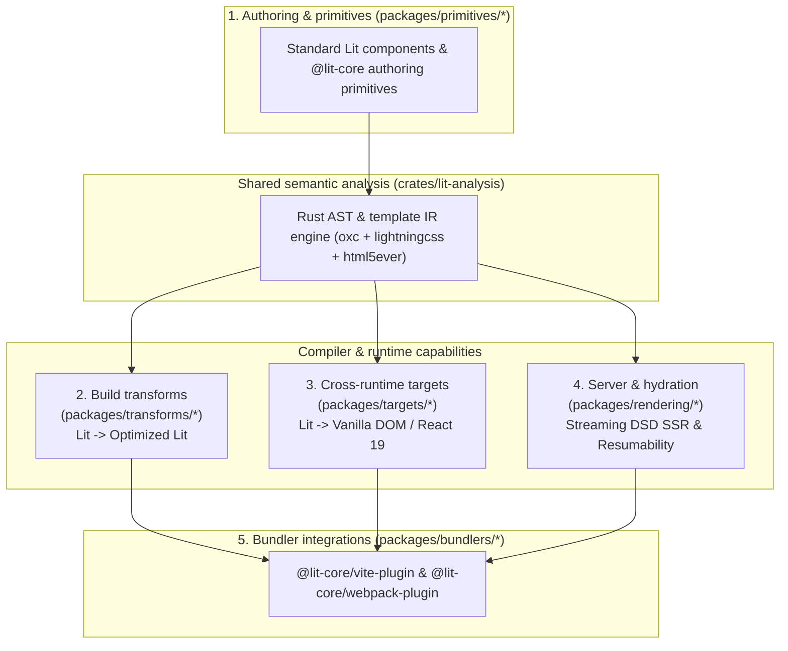

# lit-core

---

## Overview

`@lit-core` is an ahead-of-time (AOT) compiler, cross-framework transpiler, and server/hydration platform for Lit and Web Components. Built in Rust on top of `oxc`, `lightningcss`, and `html5ever`, `@lit-core` treats standard Lit components as a universal authoring format that can be optimized in-place, rendered on the edge with zero-JavaScript resumability, or compiled directly into native target runtimes like React 19 or vanilla Custom Elements.

---

## Architectural pillars

The monorepo is structured around six orthogonal architectural layers inside `packages/` and `crates/`:

1. **Authoring primitives (`packages/primitives/*`)**: Optional developer-facing decorators, signals, and reactive helpers that compile away ahead of time.
2. **Build transforms (`packages/transforms/*`)**: Composable AOT compiler passes (`Lit -> Optimized Lit`) that deduplicate Shadow DOM CSS, precompile templates, lower decorators and directives, and shake unused Custom Element registrations.
3. **Cross-runtime targets (`packages/targets/*`)**: Full cross-compilers (`Lit -> Target X`) that lower Lit components into vanilla Web Components (`@lit-core/native`) or native React 19 components (`@lit-core/morph-to-react`) without shipping the Lit runtime.
4. **Server rendering and hydration (`packages/rendering/*`)**: Universal Declarative Shadow DOM (DSD) streaming SSR (`@lit-core/ssr`) and zero-JavaScript interaction-driven resumption (`@lit-core/resumable`).
5. **Bundler integrations (`packages/bundlers/*`)**: Drop-in Vite, Rollup, and Webpack plugins that orchestrate file-level transforms, chunk-scoped CSS/HTML clustering, and SSR/resumable virtual modules.
6. **Verification and benchmarks (`packages/internal/*`)**: Empirical benchmark suites, Playwright Chromium verification harnesses, and interactive showcase dashboards evaluated against 5 enterprise design systems.

---

## Repository structure and packages

### 1. Build transforms (`packages/transforms/*`)
Composable build-time AST passes that optimize standard Lit components without altering authoring semantics:

| Package | Purpose |
| :--- | :--- |
| [`@lit-core/css-fuse`](packages/transforms/css-fuse/README.md) | Cross-component CSS AST deduplication into shared constructable stylesheets |
| [`@lit-core/html-fuse`](packages/transforms/html-fuse/README.md) | Cross-component static HTML and SVG fragment clustering into shared constants |
| [`@lit-core/props-lower`](packages/transforms/props-lower/README.md) | AOT `@property()` and `@state()` decorator lowering eliminating runtime reflection |
| [`@lit-core/html-aot`](packages/transforms/html-aot/README.md) | Ahead-of-time Lit template compilation into static `CompiledTemplateResult` descriptors |
| [`@lit-core/dom-paths`](packages/transforms/dom-paths/README.md) | Structural DOM child-index path compiler eliminating `TreeWalker` mount traversal |
| [`@lit-core/dirty-mask`](packages/transforms/dirty-mask/README.md) | Property-to-part dependency bitmasking with `noChange` short-circuiting |
| [`@lit-core/event-hoist`](packages/transforms/event-hoist/README.md) | Ahead-of-time ShadowRoot event listener delegation |
| [`@lit-core/directives`](packages/transforms/directives/README.md) | Ahead-of-time Lit directive lowering eliminating runtime wrapper allocations |
| [`@lit-core/memoize`](packages/transforms/memoize/README.md) | Reactive expression auto-memoization for pure collection pipelines |
| [`@lit-core/elem-proxy`](packages/transforms/elem-proxy/README.md) | Deferred custom element proxy stubs and JIT class upgrades |
| [`@lit-core/tag-shake`](packages/transforms/tag-shake/README.md) | Dead code elimination for unreferenced Custom Element registrations |
| [`@lit-core/css-minifier`](packages/transforms/css-minifier/README.md) | High-speed embedded `css` template literal minification via `lightningcss` |
| [`@lit-core/html-minifier`](packages/transforms/html-minifier/README.md) | High-speed embedded `html` and `svg` template literal minification via `oxc` |

### 2. Cross-runtime targets (`packages/targets/*`)
Compilers that lower Lit components into alternative execution targets:

| Package | Purpose |
| :--- | :--- |
| [`@lit-core/native`](packages/targets/native/README.md) | Compiles Lit components into standalone vanilla Custom Elements with a 1.8 KB micro-runtime |
| [`@lit-core/morph-to-react`](packages/targets/morph-to-react/README.md) | Compiles Lit components into native React 19 components (`useMorphHost`, scoped CSS, zero Lit runtime) |

### 3. Server rendering and hydration (`packages/rendering/*`)
Server, edge, and progressive client lifecycle engines:

| Package | Purpose |
| :--- | :--- |
| [`@lit-core/ssr`](packages/rendering/ssr/README.md) | Universal streaming Declarative Shadow DOM renderer for Node, Cloudflare Workers, Deno, and Bun |
| [`@lit-core/resumable`](packages/rendering/resumable/README.md) | Zero-JavaScript SSR and interaction-driven lazy component resumption |

### 4. Bundler integrations (`packages/bundlers/*`)
Unified bundler plugins that wire all transforms, targets, and rendering modes into build pipelines:

| Package | Purpose |
| :--- | :--- |
| [`@lit-core/vite-plugin`](packages/bundlers/vite-plugin/README.md) | Official Vite and Rollup plugin unifying all `@lit-core` capabilities |
| [`@lit-core/webpack-plugin`](packages/bundlers/webpack-plugin/README.md) | Official Webpack 5 plugin and loader unifying all `@lit-core` capabilities |

### 5. Shared Rust core and internal verification (`crates/*`, `packages/internal/*`)

| Package | Purpose |
| :--- | :--- |
| [`lit_analysis`](crates/lit-analysis) | Shared Rust semantic analysis and HTML5 template IR crate (`oxc` + `html5ever`) |
| [`@lit-core/benchmarks`](packages/internal/benchmarks/README.md) | Multi-suite bundle size, runtime latency, and SSR benchmark harness + React viewer |
| [`@lit-core/tests`](packages/internal/tests/README.md) | Real-component Playwright Chromium verification suite across 5 design systems |
| [`@lit-core/test-kit`](packages/internal/test-kit/README.md) | Sandboxed Playwright Chromium runner and Shadow DOM test utilities |
| [`@lit-core/showcase`](packages/internal/showcase/README.md) | Interactive multi-framework component showcase comparing isolated compiler passes |

---

## Empirical performance

Evaluated across 20 canonical components from 5 enterprise design systems (Carbon Web Components, Spectrum Web Components, Web Awesome, Momentum Design, Material Web):

| Metric | Baseline production build | With `@lit-core` full suite | Measured improvement |
| :--- | ---: | ---: | ---: |
| Raw bundle size (Carbon) | 1,405.1 KB (1,438,781 B) | 984.2 KB (1,007,814 B) | -30.0% (-420.9 KB) |
| Gzipped bundle size (Carbon) | 181.9 KB (186,286 B) | 154.1 KB (157,788 B) | -15.3% (-27.8 KB) |
| First render mount latency (Carbon) | 96.0 ms | 40.4 ms | +57.9% faster mount |
| First render mount latency (Spectrum) | 52.3 ms | 24.7 ms | +52.8% faster mount |
| First render mount latency (Momentum) | 39.6 ms | 18.1 ms | +54.3% faster mount |
| Reactive update latency (Carbon) | 4.6 ms | 2.0 ms | +56.5% faster updates |
| Reactive update latency (Momentum) | 1.1 ms | 0.5 ms | +54.5% faster updates |
| Script eval latency (Web Awesome) | 6.2 ms | 3.3 ms | +46.8% faster eval |
| Collection reconciliation (`memoize`) | 48.2 ms | 0.2 ms | -99.5% latency reduction |
| Initial JS payload on boot (`resumable`) | 420.5 KB | 1.2 KB | -99.6% initial download |

---

## Contributing and architecture

- [Contributing guide](CONTRIBUTING.md): Environment setup, prerequisites, building native Rust crates, and running tests.
- [Monorepo architecture guidelines](AGENTS.md): Architectural principles, safety invariants, and general-purpose design constraints.

---

## License

MIT
