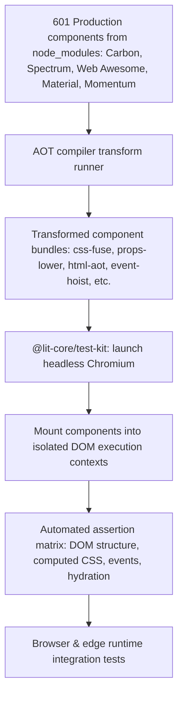

# @lit-core/tests

> Exhaustive Playwright Chromium test suite verifying `@lit-core` compiler transforms against real production component code from 5 major enterprise design systems.

---

## Introduction

### What is it?

`@lit-core/tests` is an integration test suite that verifies `@lit-core` compiler passes against 601 production Web Components from 5 industry design systems, validating DOM rendering, hydration, styling, and event handling inside real headless Chromium.

### Why does it exist?

Testing compiler transforms on synthetic code snippets or toy counter examples creates a false sense of security:
- Production component libraries feature intricate CSS inheritance, custom element lifecycles, complex decorator configurations, and nested Shadow DOM boundaries.
- A compiler bug in CSS deduplication or decorator lowering might pass synthetic tests but break layout, event dispatch, or theme tokens in real enterprise components.
- Direct verification against authentic component source code in real browser engines is essential to ensure zero regressions across production applications.

### How does it work?

The test harness runs an end-to-end verification pipeline:
1. Reads authentic component source files directly from `node_modules` for IBM Carbon, Adobe Spectrum, Web Awesome, Material Web, and Cisco Momentum.
2. Applies `@lit-core` compiler passes (such as `css-fuse`, `props-lower`, `html-aot`, `event-hoist`, `dom-paths`, `resumable`) to the real component source.
3. Launches headless Chromium using `@lit-core/test-kit` under sandbox-safe execution flags.
4. Mounts the compiled components into isolated page contexts and executes assertions covering DOM tree structure, computed CSS styles, reactive property updates, and event propagation across all suites.

---

## Architecture



### In-depth technical details

#### 1. Test suites and coverage matrix

| Suite category                   | Packages verified                                                                                                                                                            | Test files                                                                                                             |
| :------------------------------- | :--------------------------------------------------------------------------------------------------------------------------------------------------------------------------- | :--------------------------------------------------------------------------------------------------------------------- |
| Design system verification       | [`@lit-core/css-fuse`](../../transforms/css-fuse/README.md), [`@lit-core/props-lower`](../../transforms/props-lower/README.md), [`@lit-core/html-aot`](../../transforms/html-aot/README.md), [`@lit-core/event-hoist`](../../transforms/event-hoist/README.md), [`@lit-core/dom-paths`](../../transforms/dom-paths/README.md), [`@lit-core/dirty-mask`](../../transforms/dirty-mask/README.md), [`@lit-core/memoize`](../../transforms/memoize/README.md), [`@lit-core/directives`](../../transforms/directives/README.md), [`@lit-core/elem-proxy`](../../transforms/elem-proxy/README.md), [`@lit-core/html-fuse`](../../transforms/html-fuse/README.md), [`@lit-core/css-minifier`](../../transforms/css-minifier/README.md), [`@lit-core/html-minifier`](../../transforms/html-minifier/README.md), [`@lit-core/tag-shake`](../../transforms/tag-shake/README.md) | `src/suites/carbon.test.ts`, `src/suites/spectrum.test.ts`, `src/suites/webawesome.test.ts`, `src/suites/material.test.ts`, `src/suites/momentum.test.ts` |
| Bundler plugin pipelines         | [`@lit-core/vite-plugin`](../../bundlers/vite-plugin/README.md), [`@lit-core/webpack-plugin`](../../bundlers/webpack-plugin/README.md)                                       | `src/suites/plugins.test.ts`, `src/suites/plugins-ssr.test.ts`                                                         |
| AOT compilation targets          | [`@lit-core/native`](../../targets/native/README.md), [`@lit-core/morph-to-react`](../../targets/morph-to-react/README.md)                                                   | `src/suites/native.test.ts`, `src/suites/morph-to-react.test.ts`                                                       |
| Streaming SSR & resumability     | [`@lit-core/ssr`](../../rendering/ssr/README.md), [`@lit-core/resumable`](../../rendering/resumable/README.md)                                                               | `src/suites/ssr-engine.test.ts`, `src/suites/ssr-isolate.test.ts`, `src/suites/ssr-dsd-chromium.test.ts`, `src/suites/ssr-adversarial.test.ts`, `src/suites/resumable-e2e.test.ts` |
| Server elements & edge splitting | [`@lit-core/server-elements`](../../primitives/server-elements/README.md), [`@lit-core/server-split`](../../transforms/server-split/README.md)                               | `src/suites/server-elements-e2e.test.ts`, `src/suites/server-elements-workerd.test.ts`, `src/suites/server-elements-vendor.test.ts`, `src/suites/server-elements-minified.test.ts`, `src/suites/server-elements-adversarial.test.ts` |
| Visual showcase verification     | [`@lit-core/showcase`](../showcase/README.md)                                                                                                                                | `src/suites/showcase.test.ts`                                                                                          |

#### 2. Evaluated design systems

The suite validates 601 production components in total:
- **Carbon Web Components** (`@carbon/web-components`): 284 components
- **Adobe Spectrum Web Components** (`@spectrum-web-components`): 93 components
- **Web Awesome** (`@awesome.me/webawesome`): 73 components
- **Google Material Web** (`@material/web`): 54 components
- **Cisco Momentum Design** (`@momentum-design/components`): 97 components

---

## Running the tests

Run the complete test suite across all suites:

```bash
pnpm --filter @lit-core/tests test
```

Run a specific design system or feature suite:

```bash
pnpm --filter @lit-core/tests run test:carbon
pnpm --filter @lit-core/tests run test:spectrum
pnpm --filter @lit-core/tests run test:webawesome
pnpm --filter @lit-core/tests run test:material
pnpm --filter @lit-core/tests run test:momentum
pnpm --filter @lit-core/tests run test:plugins
pnpm --filter @lit-core/tests run test:native
pnpm --filter @lit-core/tests run test:ssr
pnpm --filter @lit-core/tests run test:showcase
```

---

## Cross references

- Browser test runner kit: [`@lit-core/test-kit`](../test-kit/README.md)
- Benchmark harness: [`@lit-core/benchmarks`](../benchmarks/README.md)
- Monorepo guidelines: [Monorepo architecture](../../../AGENTS.md)

---

## License

MIT
