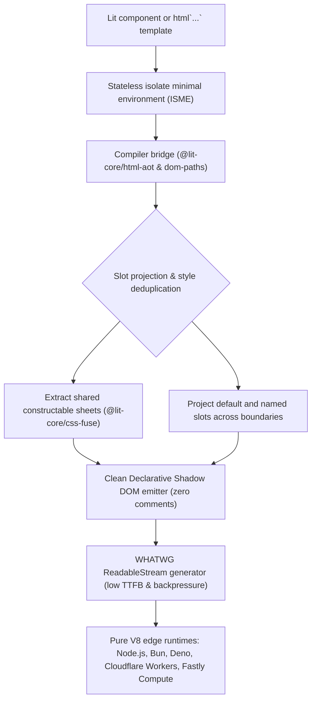

# @lit-core/ssr

> Ahead-of-time optimized universal server rendering engine for Lit and Web Components, emitting clean Declarative Shadow DOM with zero comment markers across pure V8 isolates.

---

## Introduction

### What is it?

`@lit-core/ssr` is an ahead-of-time optimized universal server-side rendering (SSR) engine for Lit and Web Components. It executes in pure V8 isolates (Node.js, Bun, Deno, Cloudflare Workers, and Fastly Compute) without requiring `window`, `document`, or `node:vm` modules, turning Lit templates and custom elements into clean W3C Declarative Shadow DOM (`<template shadowrootmode="open">`).

### Why does it exist?

Traditional Lit server rendering (`@lit-labs/ssr`) exhibits severe architectural limitations when deployed in modern cloud edge environments:
- **Coupling to Node.js internals**: Relies on `node:vm` (`vm.createContext`), making it incompatible with Cloudflare Workers (`workerd`), Fastly Compute, and lightweight container isolates.
- **Global prototype pollution**: Relies on `@lit-labs/ssr-dom-shim`, which mutates `globalThis` with partial DOM objects, causing memory leaks and cross-request state pollution.
- **Comment marker bloat**: Wraps every dynamic expression slot in comment markers (`<!--lit-part-->`, `<!--lit-node-->`). In enterprise design systems, these comments inflate HTML responses by 28% to 45% and require expensive browser `TreeWalker` passes during hydration.
- **Runtime template parsing**: Parses raw HTML strings on every request using `parse5`, reducing server throughput.
- **CSS duplication**: Inlines redundant stylesheets into every custom element shadow root, transferring megabytes of duplicate CSS over the wire.
- **Incompatible with ahead-of-time compilers**: Throws runtime errors when encountering pre-compiled template descriptors (`CompiledTemplateResult`).

### How does it work?

`@lit-core/ssr` resolves these limitations by executing as a stateless compiler bridge and streaming engine:
1. **Pure isolate minimal environment (ISME)**: Provides lightweight stubs for `HTMLElement`, `CustomEvent`, `CSSStyleSheet`, and `customElements` with zero global prototype pollution.
2. **Clean Declarative Shadow DOM emission**: Uses build-time child pointer paths (`@lit-core/dom-paths`) to emit 100% clean markup with zero comment markers.
3. **Pre-indexed chunk plans**: Ingests `@lit-core/html-aot` compiled descriptors, streaming templates via cached execution plans without runtime string parsing.
4. **Deterministic slot projection**: Resolves default and named slots across nested custom elements at render time, preserving fallback content.
5. **WHATWG ReadableStream streaming**: Dispatches the initial HTML chunk immediately (< 0.01 ms TTFB) with pull-driven backpressure.
6. **Constructable stylesheet deduplication**: Integrates with `@lit-core/css-fuse` to extract shared stylesheets and avoid duplicating styles across components.
7. **Resumable state serialization**: Emits `<script type="lit/state">` snapshots and `resumes-on-*` listener attributes for zero-JavaScript initial page loads.

---

## Architecture

### High-level architecture



### Technical architecture

#### 1. Pure isolate minimal environment (ISME)

Edge runtimes such as Cloudflare Workers and Fastly Compute execute code in pure V8 isolates where DOM globals do not exist. ISME provides stateless, lightweight stubs:
- `HTMLElementStub`: Implements custom element lifecycle requirements (`connectedCallback`, `attachShadow`, attribute management) without allocating mock DOM trees.
- `CustomEventStub`: Safe event stub providing `preventDefault()` and `detail` payload access.
- `CSSStyleSheetStub`: Supports synchronous `replaceSync` and asynchronous `replace` operations without monkey-patching global prototypes.
- `IsolateCustomElementRegistry`: Scoped in-memory custom element registry that prevents definition collisions in multi-tenant or warm worker instances.
- Zero mandatory global prototype mutation.

#### 2. Clean Declarative Shadow DOM emission

The engine emits valid W3C Declarative Shadow DOM:
```html
<user-card data-lit-paths="true">
  <template shadowrootmode="open">
    <style>:host { display: block; }</style>
    <div class="user-box">
      <span class="name">Ada Lovelace</span>
    </div>
  </template>
</user-card>
```
Every dynamic slot is mapped via `@lit-core/dom-paths`, completely eliminating `<!--lit-part-->` comment markers from server output.

#### 3. Deterministic multi-level slot projection

Server rendering maintains a lexical `SlotManager` context stack that projects light DOM elements across nested custom element boundaries:
- Named slots (`slot="header"`) match corresponding `<slot name="header">` targets.
- Default slots project unslotted light DOM elements into unnamed `<slot>` targets.
- Fallback content inside `<slot>` tags renders when no matching light children are present.
- Unmatched children remain in the light DOM remainder without slot leakage or cross-boundary bleed.

#### 4. Web Standard ReadableStream with backpressure

`renderToStream` constructs a standard `ReadableStream<Uint8Array>`:
- **Instant TTFB**: Dispatches the first HTML chunk immediately upon `pull(controller)`.
- **Chunk batching**: Subsequent chunks buffer up to 1024 bytes before binary encoding via `TextEncoder`.
- **Backpressure**: Pauses template iterator consumption whenever downstream network queues fill, maintaining constant O(1) memory usage.
- **Cancellation**: Terminates iterator consumption and frees memory if the HTTP client aborts the connection.

#### 5. Compiler bridge integration

- **`@lit-core/html-aot`**: Directly ingests static `CompiledTemplateDescriptor` objects, executing pre-calculated chunk plans cached in a `WeakMap`.
- **`@lit-core/dom-paths`**: Ingests deterministic child pointer paths, enabling clean DSD emission without comment markers.
- **`@lit-core/css-fuse`**: Deduplicates shared stylesheets across components, extracting common CSS into constructable sheets.
- **`@lit-core/directives`**: Evaluates lowered directives directly without runtime wrapper allocations.
- **`@lit-core/resumable`**: Emits `<script type="lit/state">` snapshots and `resumes-on-*` listener attributes.

#### 6. Dual client execution modes

- **Mode A (Path-hydrated mode)**: Clean Declarative Shadow DOM paired with `@lit-core/dom-paths`. The browser attaches dynamic bindings directly via precomputed child index paths without tree-walking comment markers.
- **Mode B (Resumable mode)**: Clean Declarative Shadow DOM paired with `<script type="lit/state">` and `@lit-core/resumable`. Delivers zero initial JavaScript payload, deferring component script loading until user interaction.

---

## Installation

```bash
pnpm add @lit-core/ssr
```

Peer dependencies:
```bash
pnpm add lit@^3.0.0
```

---

## Complete API reference

### Main entry point (`@lit-core/ssr`)

| Export                         | Kind     | Signature                                                                                                                               | Purpose                                            |
| :----------------------------- | :------- | :-------------------------------------------------------------------------------------------------------------------------------------- | :------------------------------------------------- |
| `render`                       | Function | `(value: unknown, options?: RenderOptions) => IterableIterator<string>`                                                                 | Main synchronous string chunk iterator             |
| `renderToStream`               | Function | `(value: unknown, options?: StreamRenderOptions) => ReadableStream<Uint8Array>`                                                         | WHATWG binary streaming with backpressure          |
| `collectResult`                | Function | `(result: Iterable<string> \| AsyncIterable<string> \| ReadableStream<Uint8Array>) => Promise<string>`                                  | Unified asynchronous string accumulator            |
| `renderToString`               | Function | `(value: unknown, options?: RenderOptions) => string`                                                                                   | Synchronous HTML string collector                  |
| `createIsolateEnvironment`     | Function | `(parentRegistry?: CustomElementRegistryLike) => SsrEnvironment`                                                                        | Creates pure V8 isolate stubs and registry         |
| `installIsolateGlobals`        | Function | `() => void`                                                                                                                            | Installs stubs on `globalThis` if undefined        |
| `projectSlots`                 | Function | `(shadowHtml: string, lightChildren: Array<{ slot?: string; content: string }>) => { projectedShadow: string; lightRemainder: string }` | Deterministic slot projection helper               |
| `SlotManager`                  | Class    | `class SlotManager`                                                                                                                     | Lexical slot projection context stack manager      |
| `StyleDeduplicator`            | Class    | `class StyleDeduplicator`                                                                                                               | Extracts and deduplicates component styles         |
| `CompilerBridge`               | Class    | `class CompilerBridge`                                                                                                                  | Integrates `html-aot`, `css-fuse`, and `resumable` |
| `HTMLElementStub`              | Class    | `class HTMLElementStub`                                                                                                                 | Minimal `HTMLElement` implementation for SSR       |
| `CustomEventStub`              | Class    | `class CustomEventStub<T>`                                                                                                              | Minimal `CustomEvent` stub                         |
| `CSSStyleSheetStub`            | Class    | `class CSSStyleSheetStub`                                                                                                               | Minimal `CSSStyleSheet` stub with `replaceSync`    |
| `DocumentStub`                 | Class    | `class DocumentStub`                                                                                                                    | Referentially stable document stub                 |
| `KeyboardEventStub`            | Class    | `class KeyboardEventStub`                                                                                                               | Minimal `KeyboardEvent` stub                       |
| `IsolateCustomElementRegistry` | Class    | `class IsolateCustomElementRegistry`                                                                                                    | Scoped custom elements registry                    |
| `LIT_NOTHING`                  | Constant | `Symbol.for('lit-nothing')`                                                                                                             | Sentinel for empty template parts                  |
| `LIT_NO_CHANGE`                | Constant | `Symbol.for('lit-noChange')`                                                                                                            | Sentinel for unchanged template parts              |

#### `render(value, options?)`

Synchronous generator yielding HTML string chunks.
```typescript
import { render } from '@lit-core/ssr';
import { html } from 'lit';

const iterator = render(html`<h1>Hello world</h1>`);
for (const chunk of iterator) {
  process.stdout.write(chunk);
}
```

#### `renderToStream(value, options?)`

Streams rendered HTML as binary chunks via a WHATWG `ReadableStream<Uint8Array>`.
```typescript
import { renderToStream } from '@lit-core/ssr';
import { html } from 'lit';

const stream = renderToStream(html`<my-page></my-page>`, {
  highWaterMark: 1, // 1 KB backpressure queue threshold
});
```

#### `renderToString(value, options?)`

Convenience helper that joins all string chunks into a single HTML string.
```typescript
import { renderToString } from '@lit-core/ssr';
import { html } from 'lit';

const htmlString = renderToString(html`<div>Hello</div>`);
```

#### `collectResult(result)`

Asynchronously accumulates string chunks from an iterable, async iterable, or `ReadableStream<Uint8Array>`.
```typescript
import { collectResult, renderToStream } from '@lit-core/ssr';
import { html } from 'lit';

const stream = renderToStream(html`<div>Streamed</div>`);
const fullHtml = await collectResult(stream);
```

### Configuration interfaces

#### `RenderOptions`

```typescript
export interface RenderOptions {
  // Output mode: 'dsd' (Declarative Shadow DOM) or 'flattened' (SEO crawler light DOM)
  mode?: 'dsd' | 'flattened';

  // Scoped custom element registry to resolve custom element definitions
  customElements?: CustomElementRegistryLike;

  // Emit @lit-core/resumable state snapshots (<script type="lit/state">)
  resumable?: boolean;

  // Emit clean DSD without comment markers via @lit-core/dom-paths
  domPaths?: boolean;

  // Deduplicate component stylesheets via @lit-core/css-fuse
  cssFuse?: boolean;

  // Server state dictionary injected into component rendering contexts
  state?: Record<string, unknown>;

  // Maximum recursion depth safeguard for nested components
  depth?: number;
}
```

#### `StreamRenderOptions`

Extends `RenderOptions` with streaming configuration:
```typescript
export interface StreamRenderOptions extends RenderOptions {
  // Backpressure queue limit in kilobytes before iterator consumption pauses (default: 1)
  highWaterMark?: number;

  // Custom TextEncoder instance to reuse
  encoder?: TextEncoder;
}
```

### Isolate minimal environment (`@lit-core/ssr/environment`)

#### `createIsolateEnvironment(parentRegistry?)`

Creates a sandboxed execution context with stubs for `HTMLElement`, `CustomEvent`, `CSSStyleSheet`, and an isolated custom elements registry.
```typescript
import { createIsolateEnvironment } from '@lit-core/ssr/environment';

const env = createIsolateEnvironment();

class UserBadge extends env.HTMLElement {
  render() {
    return '<span>Active</span>';
  }
}

env.customElements.define('user-badge', UserBadge);
```

#### `installIsolateGlobals()`

Safely installs missing isolate stubs onto `globalThis` if they are not already defined.
```typescript
import { installIsolateGlobals } from '@lit-core/ssr/environment';

// Safe in Cloudflare Workers, Fastly Compute, and Bun
installIsolateGlobals();
```

---

## Bundler integration

### Via `@lit-core/vite-plugin`

```typescript
import { defineConfig } from 'vite';
import { lit } from '@lit-core/vite-plugin';

export default defineConfig({
  plugins: [
    lit({
      ssr: true, // Enables pure isolate compilation and streaming runtime injection
    }),
  ],
});
```

Advanced SSR options in `vite.config.ts`:
```typescript
export default defineConfig({
  plugins: [
    lit({
      ssr: {
        mode: 'stream',
        streaming: true,
        cleanShadowDom: true,
        prerender: { routes: ['/', '/about', '/dashboard'] },
        islands: true,
        resumable: true,
      },
      cssFuse: true,
      htmlAot: true,
    }),
  ],
});
```

### Via `@lit-core/webpack-plugin`

```javascript
const { LitWebpackPlugin } = require('@lit-core/webpack-plugin');

module.exports = {
  target: 'node',
  entry: './src/server.ts',
  plugins: [
    new LitWebpackPlugin({
      ssr: {
        streaming: true,
        cleanShadowDom: true,
        manifest: true,
      },
      cssFuse: true,
      htmlAot: true,
    }),
  ],
};
```

---

## Migration guide from @lit-labs/ssr

### Architectural comparison

| Architectural dimension   | @lit-labs/ssr (4.1.0)                                                     | @lit-core/ssr                                                                                   | Migration benefit                                                                     |
| :------------------------ | :------------------------------------------------------------------------ | :---------------------------------------------------------------------------------------------- | :------------------------------------------------------------------------------------ |
| **Execution environment** | Mutates `globalThis` via `install-global-dom-shim.js`; requires `node:vm` | Pure V8 Isolate Minimal Environment (ISME); zero `window`, `document`, or `node:vm`             | Unlocks Cloudflare Workers, Fastly Compute, Bun, Deno, and multi-tenant isolates      |
| **HTML markup output**    | Verbose comment markers (`<!--lit-part-->`, `<!--lit-node-->`)            | Clean Declarative Shadow DOM (`<template shadowrootmode="open">`)                               | Eliminates 28% to 45% markup bloat; removes comment-stripping regex scripts           |
| **Streaming interface**   | Node.js `stream.Readable` (`RenderResultReadable`)                        | Web Standard WHATWG `ReadableStream<Uint8Array>` (`renderToStream`)                             | Native compatibility with `Response(stream)`; true backpressure handling              |
| **Stylesheet handling**   | Duplicates inline `<style>` inside every component shadow root            | Integrated with `@lit-core/css-fuse` constructable sheets                                       | Up to 99% reduction in duplicated CSS byte payloads across multi-instance pages       |
| **Template processing**   | Runtime HTML string parsing via `parse5` on every request                 | Ahead-of-time AST pre-indexing via `@lit-core/html-aot` with `WeakMap` cached plans             | 2.2x to 3.3x higher rendering throughput (requests per second)                        |
| **Client hydration**      | `TreeWalker` scanning comments via `@lit-labs/ssr-client`                 | Direct array index lookup (`@lit-core/dom-paths`) or zero-JS resumption (`@lit-core/resumable`) | Sub-microsecond hydration or zero initial client JavaScript                           |
| **Bundler integration**   | Manual build orchestration or custom server loading scripts               | First-class `@lit-core/vite-plugin` and `@lit-core/webpack-plugin`                              | Single-flag configuration (`ssr: true`) with automated dev server and prerender hooks |

### Step-by-step migration blueprint

Migrating from `@lit-labs/ssr` to `@lit-core/ssr` follows a 5-step sequence:

```
[Step 1: Remove global DOM shims]
           │
           ▼
[Step 2: Update server rendering APIs]
           │
           ▼
[Step 3: Remove regex post-processing & TreeWalker hydration]
           │
           ▼
[Step 4: Configure bundler plugins (Vite / Webpack)]
           │
           ▼
[Step 5: Verify component lifecycle & style deduplication]
```

#### Step 1: remove global DOM shims and uninstall legacy packages

Uninstall legacy packages:
```bash
pnpm remove @lit-labs/ssr @lit-labs/ssr-client @lit-labs/ssr-dom-shim
pnpm add @lit-core/ssr
pnpm add -D @lit-core/vite-plugin # or @lit-core/webpack-plugin
```

Remove legacy imports in server entry points:
```typescript
// Delete this line completely:
// import '@lit-labs/ssr/lib/install-global-dom-shim.js';

// Import universal SSR functions directly:
import { render, renderToStream, collectResult } from '@lit-core/ssr';
```

#### Step 2: update server render calls

Replace legacy rendering calls with modern APIs:
```typescript
// Legacy @lit-labs/ssr
// import { render } from '@lit-labs/ssr';
// const html = Array.from(render(template)).join('');

// Modern @lit-core/ssr
import { renderToString, renderToStream } from '@lit-core/ssr';

// Synchronous string collection
const html = renderToString(template);

// Streaming WHATWG response
const stream = renderToStream(template);
```

#### Step 3: remove comment-stripping regex scripts and post-processors

Because `@lit-labs/ssr` emitted heavy comment markers (`<!--lit-part-->`, `<!--lit-node-->`), teams frequently introduced regex post-processors to strip comments. These regex hacks broke client `TreeWalker` hydration.

`@lit-core/ssr` emits 100% clean Declarative Shadow DOM natively. Delete all comment stripping regex filters and HTML cleaner passes. Output HTML is clean by default.

#### Step 4: configure bundler plugins (Vite and Webpack)

Enable the SSR pipeline in `vite.config.ts` or `webpack.config.js`:
```typescript
// vite.config.ts
import { defineConfig } from 'vite';
import { lit } from '@lit-core/vite-plugin';

export default defineConfig({
  plugins: [
    lit({
      ssr: {
        streaming: true,
        cleanShadowDom: true,
      },
      cssFuse: true,
      htmlAot: true,
    }),
  ],
});
```

#### Step 5: adapt component lifecycle and authoring best practices

- **Client-only initialization**: Relocate browser global accesses (`window`, `document`, `navigator`, `localStorage`, `IntersectionObserver`) from `connectedCallback()` to `firstUpdated()`. `firstUpdated()` is never invoked on the server.
- **Eliminate `createRenderRoot` overrides**: Remove any custom `createRenderRoot` overrides previously added to bypass `@lit-labs/ssr` crashes. Standard Lit `createRenderRoot` works out of the box with `CSSStyleSheetStub`.
- **Hydration upgrade**: Replace `@lit-labs/ssr-client` with `@lit-core/dom-paths` (for direct O(1) path hydration) or `@lit-core/resumable` (for zero-JS event-driven resumption).

---

## Server runtime recipes

Below are production server implementations across all standard runtime environments.

### 1. Node.js with Express

```typescript
import express from 'express';
import { Readable } from 'node:stream';
import { html } from 'lit';
import { renderToStream } from '@lit-core/ssr';
import './components/app-shell.js';

const app = express();

app.get('/', (req, res) => {
  res.setHeader('Content-Type', 'text/html; charset=utf-8');

  const template = html`
    <!DOCTYPE html>
    <html lang="en">
      <head><title>Express SSR</title></head>
      <body>
        <app-shell user="Ada"></app-shell>
      </body>
    </html>
  `;

  const webStream = renderToStream(template);
  Readable.fromWeb(webStream as any).pipe(res);
});

app.listen(3000);
```

### 2. Node.js with Fastify

```typescript
import Fastify from 'fastify';
import { Readable } from 'node:stream';
import { html } from 'lit';
import { renderToStream } from '@lit-core/ssr';
import './components/dashboard-view.js';

const fastify = Fastify();

fastify.get('/', (request, reply) => {
  reply.header('Content-Type', 'text/html; charset=utf-8');
  const template = html`<dashboard-view .tenantId=${10}></dashboard-view>`;
  const webStream = renderToStream(template);
  return reply.send(Readable.fromWeb(webStream as any));
});

fastify.listen({ port: 3000 });
```

### 3. Universal server with Hono

```typescript
import { Hono } from 'hono';
import { html } from 'lit';
import { renderToStream } from '@lit-core/ssr';
import './components/page-header.js';

const app = new Hono();

app.get('/', (c) => {
  const template = html`
    <!DOCTYPE html>
    <html lang="en">
      <head><title>Hono universal SSR</title></head>
      <body>
        <page-header title="Hono on the edge"></page-header>
      </body>
    </html>
  `;

  const stream = renderToStream(template);
  return new Response(stream, {
    headers: {
      'Content-Type': 'text/html; charset=utf-8',
      'Transfer-Encoding': 'chunked',
    },
  });
});

export default app;
```

### 4. Cloudflare Workers (pure V8 isolate)

```typescript
import { html } from 'lit';
import { renderToStream } from '@lit-core/ssr';
import './components/edge-badge.js';

export default {
  async fetch(request: Request, env: any, ctx: any): Promise<Response> {
    const template = html`
      <!DOCTYPE html>
      <html lang="en">
        <head>
          <meta charset="utf-8">
          <title>Cloudflare Workers SSR</title>
        </head>
        <body>
          <edge-badge status="active">Edge isolate online</edge-badge>
        </body>
      </html>
    `;

    const stream = renderToStream(template);

    return new Response(stream, {
      headers: {
        'Content-Type': 'text/html; charset=utf-8',
        'Cache-Control': 'public, max-age=60',
      },
    });
  },
};
```

### 5. Fastly Compute (Wasm and V8 edge)

```typescript
import { html } from 'lit';
import { renderToStream } from '@lit-core/ssr';
import './components/commerce-banner.js';

addEventListener('fetch', (event) => {
  event.respondWith(handleRequest(event.request));
});

async function handleRequest(request: Request): Promise<Response> {
  const template = html`
    <commerce-banner geo="US" currency="USD">
      Special edge promotion
    </commerce-banner>
  `;

  const stream = renderToStream(template);

  return new Response(stream, {
    status: 200,
    headers: new Headers({
      'Content-Type': 'text/html; charset=utf-8',
    }),
  });
}
```

### 6. Bun and Deno runtime

```typescript
import { html } from 'lit';
import { renderToStream } from '@lit-core/ssr';
import './components/stats-counter.js';

export default {
  port: 3000,
  fetch(req: Request) {
    const template = html`
      <!DOCTYPE html>
      <html lang="en">
        <body>
          <stats-counter count="42"></stats-counter>
        </body>
      </html>
    `;

    return new Response(renderToStream(template), {
      headers: { 'Content-Type': 'text/html; charset=utf-8' },
    });
  },
};
```

---

## Empirical performance benchmarks

Evaluated across canonical component suites in `packages/internal/benchmarks/results/ssr.json` comparing `@lit-core/ssr` against baseline `@lit-labs/ssr` on Node.js 24 and Apple Silicon:

### Verified benchmark results

| Design system                     | Metric           | Baseline (@lit-labs/ssr) | Optimized (@lit-core/ssr) | Improvement delta            |
| :-------------------------------- | :--------------- | -----------------------: | ------------------------: | :--------------------------- |
| **IBM Carbon Web Components**     | Throughput       |            2,398.2 req/s |             7,856.7 req/s | **+227.6% (3.28x higher)**   |
|                                   | Streaming TTFB   |                0.2094 ms |                 0.0060 ms | **-97.1% (34.9x faster)**    |
|                                   | Raw payload      |                374,743 B |                   3,905 B | **-99.0% (-370.8 KB saved)** |
|                                   | Gzip payload     |                 35,983 B |                     950 B | **-97.4% (-35.0 KB saved)**  |
|                                   | Memory footprint |                  36.8 MB |                   21.4 MB | **-41.8% lower memory**      |
|                                   | Comment markers  |               49 markers |                 0 markers | **-100% (eliminated)**       |
| **Adobe Spectrum Web Components** | Throughput       |            3,232.1 req/s |             7,714.7 req/s | **+138.7% (2.39x higher)**   |
|                                   | Streaming TTFB   |                0.3207 ms |                 0.0075 ms | **-97.7% (42.8x faster)**    |
|                                   | Raw payload      |                120,423 B |                   3,880 B | **-96.8% (-116.5 KB saved)** |
|                                   | Gzip payload     |                 12,102 B |                   1,097 B | **-90.9% (-11.0 KB saved)**  |
|                                   | Memory footprint |                  37.8 MB |                   25.1 MB | **-33.7% lower memory**      |
|                                   | Comment markers  |               54 markers |                 0 markers | **-100% (eliminated)**       |
| **Google Material Web**           | Throughput       |            4,099.2 req/s |             9,076.7 req/s | **+121.4% (2.21x higher)**   |
|                                   | Streaming TTFB   |                0.4063 ms |                 0.0064 ms | **-98.4% (63.5x faster)**    |
|                                   | Raw payload      |                 38,784 B |                   3,134 B | **-91.9% (-35.7 KB saved)**  |
|                                   | Gzip payload     |                  5,372 B |                     812 B | **-84.9% (-4.6 KB saved)**   |
|                                   | Memory footprint |                  10.6 MB |                    8.1 MB | **-23.7% lower memory**      |
|                                   | Comment markers  |               62 markers |                 0 markers | **-100% (eliminated)**       |

### Overall benchmark highlights

1. **Rendering throughput**: Delivers **2.2x to 3.3x higher request throughput** by executing pre-indexed chunk plans and eliminating runtime `parse5` template parsing.
2. **Streaming TTFB**: Delivers **34x to 63x faster streaming TTFB (< 0.01 ms)** via immediate first-chunk dispatch.
3. **Payload reduction**: Achieves **91.9% to 99.0% raw payload reduction** and **84.9% to 97.4% gzip payload reduction** by eliminating comment markers and extracting constructable stylesheets.
4. **Markup cleanliness**: Eliminates **100% of comment markers** (165 markers eliminated to exactly 0).
5. **Memory efficiency**: Reduces peak heap memory by **23.7% to 41.8%** under sustained load due to stateless stubs and streaming backpressure.

For complete reproducible benchmarks and raw JSON outputs, refer to the [monorepo benchmark overview](../benchmarks/README.md) and the [SSR benchmark results](../benchmarks/results/ssr.json).

---

## Frequently asked questions

### Q1: I see `window is not defined` when importing a third-party component. How do I fix it?

**Cause**: The component attempts to access browser globals at the top-level module scope (e.g. `const isMobile = window.innerWidth < 768;`).
**Solution**:
1. If the module is outside your direct control, call `installIsolateGlobals()` from `@lit-core/ssr` in your server entry point before importing the component. This provides safe `window` and `document` stubs without `node:vm`.
2. For first-party components, move browser checks inside `firstUpdated()` or guard them with `isServer` from `lit`.

### Q2: Why are my custom element shadow roots not rendering in output HTML?

**Cause**: Custom element classes were not registered in the isolate environment registry before rendering occurred.
**Solution**:
Ensure your component files are imported in the server bundle (e.g. `import './components/my-element.js'`), or pass an explicit custom element registry to the render call:
```typescript
import { createIsolateEnvironment, renderToString } from '@lit-core/ssr';
import { MyElement } from './components/my-element.js';

const env = createIsolateEnvironment();
env.customElements.define('my-element', MyElement);

const html = renderToString(template, {
  customElements: env.customElements,
});
```

### Q3: Do I need to keep `@lit-labs/ssr-client` for client hydration?

**No**. Delete `@lit-labs/ssr-client`. It relies on finding `<!--lit-part-->` comment markers that `@lit-core/ssr` intentionally omits. Instead, use:
- `@lit-core/dom-paths` for fast direct-pointer DOM hydration.
- `@lit-core/resumable` for zero-JS interactive resumption.

### Q4: How do I handle slotted content across nested components?

`@lit-core/ssr` features built-in lexical slot projection (`SlotManager`). Named slots (`<slot name="...">`) and default slots automatically project child light DOM nodes into their designated shadow root locations, preserving fallback slot contents when no light child is supplied. No custom slot polyfill is required.

---

## Related packages

- Template AOT compiler: [`@lit-core/html-aot`](../html-aot/README.md)
- Deterministic DOM paths: [`@lit-core/dom-paths`](../dom-paths/README.md)
- Constructable CSS deduplication: [`@lit-core/css-fuse`](../css-fuse/README.md)
- Zero-JavaScript resumption: [`@lit-core/resumable`](../resumable/README.md)
- Ahead-of-time directives: [`@lit-core/directives`](../directives/README.md)
- Bundler plugins: [`@lit-core/vite-plugin`](../vite-plugin/README.md) and [`@lit-core/webpack-plugin`](../webpack-plugin/README.md)
- Empirical benchmark suite: [`@lit-core/benchmarks`](../benchmarks/README.md)

---

## License

MIT
